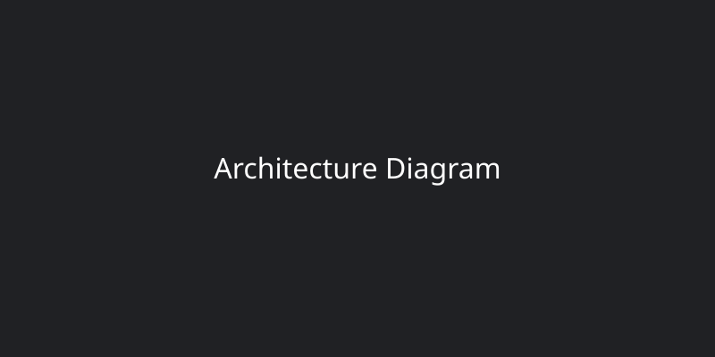

# Google Multi-Account Shield & Unlimited Session Vault

## ⚡ 1-Click Download for Users

**[📥 Download Ready-to-Use Extension (.ZIP) — Click Here](https://github.com/tawhid4x/google-multi-account-shield/releases/latest/download/google-multi-account-shield-extension.zip)**

### Installation Guide (3 Simple Steps)

**Step 1:** Click the Download button above and Extract (Unzip) the downloaded file on your computer.

**Step 2:** Open Google Chrome, type `chrome://extensions` in the address bar, press Enter, and turn ON **Developer mode** in the top-right corner.

**Step 3:** Click **Load unpacked** in the top-left corner and select the extracted folder. Done! Everything now works automatically in the background!

## 🎯 The Problem vs. Our Solution

### Standard Chrome
- Accidental "Sign out of all accounts" button right under "+ Add another account".
- Hard 10-account limit (authuser=9).
- Constant "Signed out" errors forcing manual re-logins.

### Google Multi-Account Shield
- "Sign out of all accounts" safely hidden.
- Scroll through 100 to 200+ accounts directly inside Google's native menu.
- Zero extension popup hassle, instant 1-click hot-swap.

## ✨ Key Features & Architecture Deep-Dive

- **Zero-Flash Multi-Frame CSS Shield:** Instantly hides destructive log-out actions.
- **Non-Destructive Background Cookie Vault:** Stores and hot-swaps session tokens locally.
- **Native Account Menu Injector:** Enhances the Google Account Switcher with 3D fluid scroll physics.
- **Universal OAuth Engine:** Integrates across all third-party sites using Google Sign-In.

## 🔒 100% Privacy Guarantee
Zero analytics, zero telemetry. All authentication tokens remain exclusively encrypted on your local machine using hardware-bound AES-256-GCM logic.
